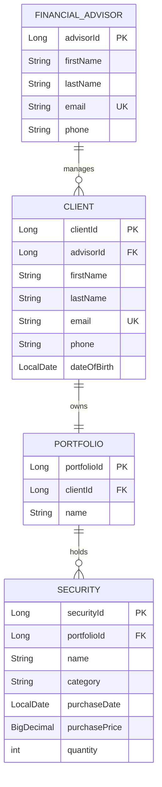

# 🏦 Wells Fargo Investment Counselor — Data Model Architecture


Data model design and relational schema mapping implemented for **Task 2 of the Wells Fargo Software Engineering Virtual Experience Program** (via Forage).

This project models the core financial domain entities required for an investment portfolio advisory platform, mapping real-world advisor-client relationships into a relational database schema using **Jakarta Persistence (JPA)** annotations and **Spring Data**.

---

## 📐 Entity Relationship Architecture



---

## 🏛️ Domain Model Specifications

### 1. `FinancialAdvisor`
- **Role**: Primary wealth advisor managing customer portfolios.
- **Cardinality**: 1-to-many relationship with `Client` (`@OneToMany(mappedBy = "advisor", cascade = CascadeType.ALL)`).
- **Constraints**: Mandatory `firstName`, `lastName`, and unique `email`.

### 2. `Client`
- **Role**: High-net-worth investor under financial advisory.
- **Cardinality**: Many-to-1 with `FinancialAdvisor`, 1-to-1 with `Portfolio` (`@OneToOne(mappedBy = "client")`).
- **Constraints**: Mandatory advisor reference (`@JoinColumn(name = "advisor_id")`), unique `email`.

### 3. `Portfolio`
- **Role**: Container grouping financial security holdings for a client.
- **Cardinality**: 1-to-1 with `Client`, 1-to-many with `Security`.
- **Constraints**: Foreign key to client table with unique constraint.

### 4. `Security`
- **Role**: Financial assets (Stocks, Bonds, Mutual Funds, ETFs) held in a portfolio.
- **Cardinality**: Many-to-1 with `Portfolio` (`@ManyToOne`).
- **Precision**: Uses `BigDecimal` with precision 19 and scale 4 to prevent floating-point rounding errors during currency math.

---

## 🧪 Testing & Verification

Comprehensive JUnit 5 test suites verify entity instantiation, bidirectional relationships, and BigDecimal financial precision:

```bash
# Run unit tests via Maven
mvn test
```

Test coverage includes:
- `testFinancialAdvisorCreation`: Verifies advisor credentials, getters, and client collection binding.
- `testClientEntityAndRelationships`: Verifies foreign key associations between advisor and client.
- `testPortfolioAndSecurities`: Verifies multi-asset holding aggregation in portfolio.
- `testSecurityPricePrecision`: Verifies monetary decimal scale adherence (`BigDecimal`).

---

## 📂 Project Structure

```
wells-fargo-task-2/
├── .github/workflows/
│   └── ci.yml               # Automated Maven build & test pipeline
├── src/
│   ├── main/java/com/wellsfargo/counselor/
│   │   ├── Entrypoint.java  # Spring Boot application entrypoint
│   │   └── entity/          # JPA Entity data models
│   │       ├── FinancialAdvisor.java
│   │       ├── Client.java
│   │       ├── Portfolio.java
│   │       ├── Security.java
│   │       └── Advisor.java
│   └── test/java/com/wellsfargo/counselor/
│       └── entity/
│           ├── InvestmentModelTest.java # JUnit 5 test suite (5 tests)
│           └── TestRunner.java          # Standalone test executor
├── pom.xml                  # Maven dependencies & build configuration
└── .gitignore               # Maven & IDE ignores
```

---

## 📄 License

Distributed under the MIT License. See `LICENSE` for more information.

---

## ⚖️ Portfolio Rebalancing & Asset Allocation Engine (`PortfolioRebalancingService`)

In wealth management, advisors actively ensure client portfolios do not drift away from target risk models:
- **Total Portfolio Valuation**: Calculates aggregate position value $\sum (\text{quantity} \times \text{purchasePrice})$ with high monetary precision.
- **Category Allocation**: Aggregates percentage weights across Equities, Fixed Income, Cash, and Alternative assets.
- **Drift & Rebalancing**: Compares current portfolio weights against client risk profile targets (e.g. 60% Equity / 40% Fixed Income), issuing discrete `BUY`, `SELL`, or `HOLD` action orders with dollar adjustments.
